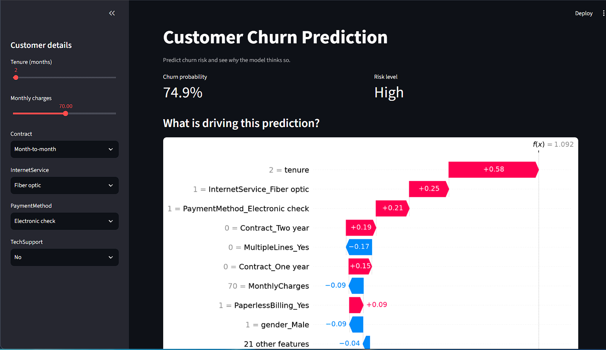

# Customer Churn Prediction

End-to-end churn prediction pipeline with explainable predictions, built with Python, Scikit-learn, XGBoost, SHAP and Streamlit.



## Results

Compared on the same held-out test set (20% split, stratified):

| Model | F1 | Recall | ROC-AUC |
|---|---|---|---|
| XGBoost | 0.582 | 0.545 | 0.840 |
| Logistic Regression | 0.611 | 0.783 | 0.839 |
| Random Forest | 0.565 | 0.521 | 0.827 |
| Decision Tree | 0.576 | 0.634 | 0.812 |

## Key decisions

- **SMOTE applied to the training set only**, after the train/test split, to avoid data leakage.
- **SHAP** explains each prediction so a business user sees the drivers of churn, not just a score.

## Run locally

```bash
pip install -r requirements.txt
python train.py
streamlit run app.py
```

## Dataset

IBM Telco Customer Churn (Kaggle).